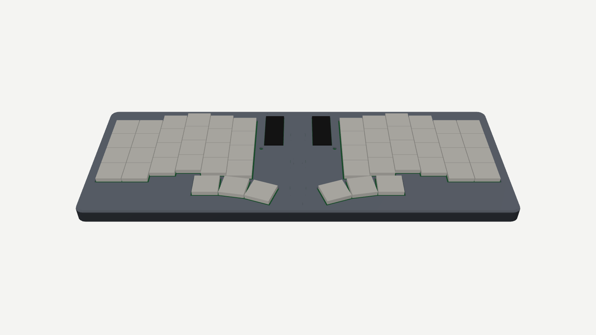

# Yoga Split Keyboard

A ZMK-powered, low-profile, wireless columnar keyboard that drops onto the lower screen of a
**Lenovo Yoga Book 9i Gen 9 (13IMU9)** in place of the bundled keyboard. It has the same
295.3 × 113 mm footprint and magnet pockets for docking.



* **Layout:** 6 × 4 columnar grid plus 3 thumb keys per side, 54 keys in total, Kailh Choc v1 at
  18 × 17 mm spacing. A 4-row layout fits, and the [fit study](docs/design.md#fit-study-4-rows-fit)
  shows why.
* **Controller and display:** a nice!nano v2 with a nice!view in the centre gap of each half.
  The monolithic version has one of each in the middle.
* **Two variants built from one ergogen config:**
  * **Split.** Two halves that join with 6 × 3 mm magnets and steel dowels for docking, or come
    apart for the desk.
  * **Monolithic.** One PCB and one controller, for comparison.
* **MX-spaced variant:** the same layout at 19.05 mm for Choc v2 / KS-33 switches with MX-stem
  keycaps also fits ([details](docs/design.md#mx-spaced-variant-ergogen-mx-pcb-mx-case-mx)). It uses
  the same firmware.
* **One cable charges both halves** while they're joined, through a magnetic pogo link in the join
  wall ([how](docs/design.md#charging-both-halves-from-one-cable-split-only)).
* **Cost and complexity:** see [docs/bom-comparison.md](docs/bom-comparison.md). Split is about
  $293 and monolithic about $216, both with a self-printed case.

## Repository layout

| Path | What |
|---|---|
| `ergogen/config.yaml`, `ergogen/footprints/` | Source of truth for key positions, outlines and all three PCBs (ergogen 4.2.1, KiCad 5 template) |
| `pcb/{left,right,mono}/` | KiCad boards (KiCad 7 format, opens in 7, 8 and 9), placed and autorouted with Freerouting |
| `pcb/gerbers/` | Gerber + drill zips, ready to upload to JLCPCB |
| `pcb/fab/` | JLCPCB BOM and CPL for the machine-assembled parts (diodes, hotswap sockets, power switch, reset button, charge-link fuse and resistor) |
| `ergogen-mx/`, `pcb-mx/` | The MX-spaced (19.05 mm) variant: config, boards, Gerbers, fab files. `ergogen-mx/footprints` links to `ergogen/footprints` |
| `case/case.scad`, `case/outlines/`, `case/stl/` | Parametric OpenSCAD case, its DXF inputs, and exported STLs (tray and frame for left, right and mono). `-D 'spacing="mx"'` builds the MX variant from `case/outlines-mx/` into `case/stl-mx/` |
| `config/`, `build.yaml` | ZMK user config: shields `yoga_split_left/right` and `yoga_mono`, plus blaise's Cannonkeys Link keymap ported to 54 keys (home row mods, NUM/NAV/FUN/MOUSE/BOARD layers; `tools/port_link_keymap.py`) and build matrix. Builds against the same `caps-word-v0.3` ZMK fork as the Link. `.github/workflows/build-zmk.yml` builds the firmware on push |
| `docs/` | [Design notes and assumptions](docs/design.md), [BOM and complexity comparison](docs/bom-comparison.md), renders |
| `tools/` | Helper scripts: board prep / DSN export, ZMK generation from ergogen points, fab CSVs |

## Status

| Part | State |
|---|---|
| Fit study and layout | Done |
| PCB schematic / netlist and placement (left, right, mono; Choc and MX) | Done |
| PCB routing | Done with Freerouting 2.1. All six boards are 100% routed with 0 DRC errors (only cosmetic silkscreen warnings). Worth a look in KiCad before ordering: there's no ground pour, and track widths are 0.25 mm signal / 0.4 mm power |
| Gerbers | Done (`pcb/gerbers/`, `pcb-mx/gerbers/`), untested at a fab |
| Case | Done, but untested on a printer |
| Docking magnet positions | **Assumed.** The laptop's EC detects the keyboard magnetically (two positions, no Bluetooth check), so the magnets have to match the stock ones. Map them with viewing film or the dotfiles' `kbdock-test.sh` (see [docs/design.md](docs/design.md#docking)) |
| ZMK firmware | Written, and built by the workflow in CI |

## Regenerating

```sh
npm i -g ergogen@4.2.1
ergogen ergogen -o build/ergogen -d          # PCBs + outlines + points
cp build/ergogen/points/points.yaml tools/   # then:
python3 tools/gen_zmk.py                     # ZMK shields from the key positions
cp build/ergogen/outlines/*.dxf case/outlines/
openscad -D 'variant="left"' -D 'part="tray"' -o case/stl/tray_left.stl case/case.scad
# KiCad python: upgrade the board, set rules, export a DSN for Freerouting
python3 tools/prep_dsn.py build/ergogen/pcbs/left.kicad_pcb pcb/left/yoga_left.kicad_pcb left.dsn
java -jar freerouting-2.1.0.jar --gui.enabled=false -de left.dsn -do left.ses -mp 200
python3 tools/import_ses.py pcb/left/yoga_left.kicad_pcb left.ses left-drc.txt   # adds tracks, runs DRC
tools/export_gerbers.sh pcb/left/yoga_left.kicad_pcb pcb/gerbers/yoga_left-gerbers.zip
python3 tools/gen_fab.py pcb/left/yoga_left.kicad_pcb pcb/fab/yoga_left
# MX variant: same steps with ergogen-mx -> build/ergogen-mx, pcb-mx/, case/outlines-mx, -D 'spacing="mx"'
```

## Build notes

1. Order the PCBs at **1.2 mm** thickness. That's what the case stack-up assumes.
2. Hotswap sockets and diodes go on the **bottom** side. The controller, display, battery, power
   switch and reset button go on the **top**.
3. Mount the nice!nano with its components facing the PCB, matching the silkscreen labels. Solder
   it directly, without tall sockets, so the nice!view on top sits flush with the top frame.
4. Press M2 heat-set inserts into the tray standoffs, and screw the PCB down from the top with
   M2 × 4 low-head screws.
5. Fit the magnetic pogo connector on the split edge of each half: spring pins on the left, flat
   targets on the right. Before closing the case, check both pins line up and that GND matches GND.
6. Glue the docking magnets into the pockets you mapped, and the joining magnets and dowels into
   the split faces.
