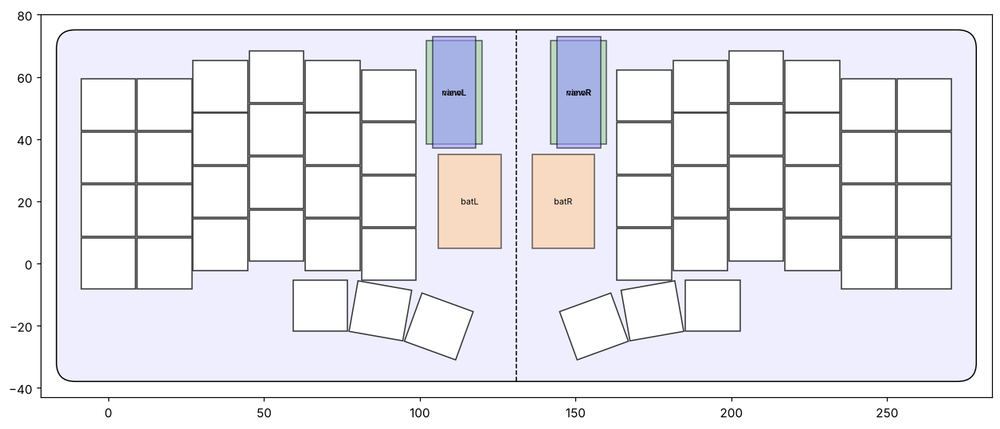
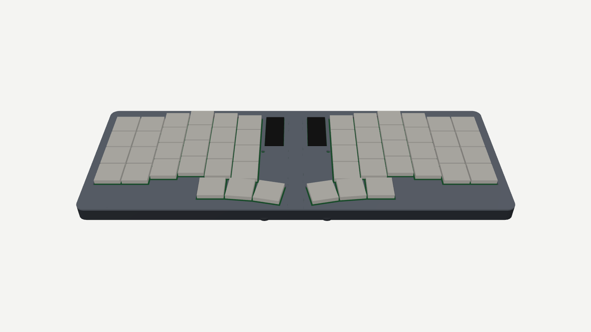

# Design notes

## Target envelope

| | Value | Source |
|---|---|---|
| Stock keyboard ("Yoga Book 9 Bluetooth KB") | **295.3 × 113 × 7.8 mm**, 850 mAh, USB-C charging, Bluetooth 5.2 | Lenovo *User Guide Yoga Book 9i (13", 9)*, model 13IMU9, p. 10 (same figures in the Gen 8 / 13IRU8 guide) |
| Laptop body | 299.1 × 203.9 × 15.95 mm | Lenovo spec page for 13IMU9 |
| Lower display | 13.3" 16:10, 2880 × 1800; active area ≈ 286.5 × 179.1 mm (calculated) | Lenovo PSREF |
| Docking behaviour | On the upper part of the bottom screen, a virtual touchpad appears below the keyboard. On the lower part, a widget bar appears above it. | User guide p. 23 |
| Hall sensors | "Hall sensor: 4" in the system sensor table; what they detect is not stated | User guide p. 9, PSREF |

This design matches the **295.3 × 113 mm footprint** exactly (6 mm corner radius, which is assumed).
It does **not** match the 7.8 mm thickness. Choc switches with hotswap sockets and a 3D-printed case
come out at about **10 mm to the frame top and ~13 mm to the keycap tops**. See *Stack-up* below.

## Fit study: 4 rows fit



The layout per half is 6 columns × 4 rows, plus a 3-key thumb arc (10° splay per key). It uses Kailh
Choc spacing (18 × 17 mm) with Voyager-like column stagger (ring +6, middle +3, index −3, inner
−3 mm relative to the neighbouring column).

* Key block depth including thumbs: **99.2 mm**, against 113 mm available, leaving ~7 mm of border
  front and back.
* Width: outer edges sit 7.9 mm inside the envelope. The **centre gap between the two inner columns
  is 64.5 mm**. Each half uses its 32 mm of that gap for a nice!nano with a nice!view stacked on
  top, a 20 × 30 mm LiPo, the reset button and the join wall.
* **19.05 mm (MX-style) spacing also fits** with a few changes. See the next section.

## MX-spaced variant (`ergogen-mx/`, `pcb-mx/`, `case/*-mx`)



The same 6 × 4 + 3 layout at 19.05 × 19.05 mm, for Kailh Choc v2 or Gateron KS-33 low-profile
switches with MX-stem keycaps. An earlier estimate here said this wouldn't fit. That estimate kept
the Choc thumb arc, and a flatter arc fixes it:

| | Choc (18 × 17) | MX (19.05) |
|---|---|---|
| Thumb arc | 10° per key | 6° per key, tucked 0.5 mm closer to the matrix |
| Ring finger stagger | +6 mm | +5 mm |
| Key block depth incl. thumbs | 99.2 mm | **104 mm** (≈ 4.5 mm front/back border inside the 113 mm envelope) |
| Side border | 7.9 mm | **3 mm** (keycap edge ~1 mm from the inner wall face) |
| Centre gap between inner columns | 64.5 mm | **62.8 mm** |
| Stack-up to frame top / keycap tops | 10.0 / ~12.7 mm | 10.0 / ~13.3 mm (Choc v2 is ~0.6 mm taller) |

The screens didn't have to shrink: each half's 31 mm share of the gap still holds the nice!nano,
a nice!view on top, the 20 × 30 mm LiPo and the reset button. What it costs is thinner outer borders,
a flatter thumb arc and a slightly taller board.

The matrix, pins and nets are identical to the Choc boards, so the **same ZMK shields and firmware**
run both. Only the physical layout ZMK Studio draws is the Choc one. The Choc hotswap socket
(CPG135001S30) fits Choc v2 too.

## Stack-up (z from the laptop screen up)

| Layer | Thickness | Top at |
|---|---|---|
| Case floor (docking magnets sit in blind pockets with a 0.4 mm skin) | 1.0 | 1.0 |
| Air gap for the THT diode bodies (1.9 mm), or the hotswap sockets (1.85 mm) on route B | 2.2 | 3.2 |
| PCB (order at 1.2 mm) | 1.2 | 4.4 |
| Controller, battery and nice!view under the top frame | 4.4 | 8.8 |
| Top frame | 1.2 | **10.0** |
| Choc v1 switch + low-profile keycap above the PCB | ~8.3 | **~12.7** |

Ways to get thinner, roughly in order of payoff:
1. Route B with SMD diodes and the switches soldered in instead of the sockets: −1.2 mm (gap shrinks to ~1 mm).
2. Kailh PG1316S ultra-low-profile switches (solder-only, own keycaps): roughly −3 mm. This
   needs a new footprint and isn't designed here.
3. Mount the nice!nano face-down without sockets and use a 1 mm FR4 frame instead of print: −1 mm.

## Docking

### What the laptop actually detects (from blaise's dotfiles)

blaise runs Linux on this Yoga Book and has written up how it detects the keyboard
([dotfiles `docs/yoga-book/kbdock.md`, `hardware.md`, `yoga/kbdock-dkms/lenovo-yb9-kbdock.c`](https://github.com/BlaiseRideout/dotfiles)):

* **Detection is done by the laptop's embedded controller, not over Bluetooth.** The EC keeps a 2-bit
  field `BKBD` and raises WMI event `0xEB` (GUIDs `806BD2A2-…` and `E7F300FA-…`) when it changes.
  The keyboard itself is a plain Bluetooth HID device (`17ef:616a`), and its USB-C port only charges.
  Nothing in that chain checks the keyboard's identity, so a third-party keyboard that reproduces the
  magnetic field gets the same docking behaviour on Windows and Linux.
* **There are two docked positions, and the EC tells them apart:** `1` = near the hinge, `2` = at
  the front edge, `0` = away. Sliding between the two reads `0` for about a second on the way. So
  the keyboard's magnets have to trigger a different sensor (or set of sensors) in each position.
* **Footprint check:** in the touchpad write-up, the keyboard's edge sits at **0.63 of the bottom
  screen's height** when it's docked near the hinge. 0.63 × 179.1 mm ≈ 113 mm, which matches the
  113 mm depth this design uses.
* The hinge sensor's `keyboard` channel always reads 0, and one hall sensor is the lid sensor. That
  leaves the others as the likely dock sensors. Their positions under the panel are still not published.

### So the magnets matter, and their positions are still an assumption

The case has **13 candidate docking-magnet pockets per half** (26 total), each 6.2 mm in diameter
and 1.6 mm deep, for 6 × 1.5 mm N52 discs. They sit along the back edge, the front edge and the
outer edge, plus two in the controller area near the centre line. They're opened from the inside,
so the bottom face stays smooth on the glass.

### Mapping the real positions

**Option A: magnetic viewing film (≈10 minutes, no laptop needed).**
1. Lay magnetic viewing film on the underside of the stock keyboard and trace the dark spots
   (pole boundaries) onto paper at 1:1.
2. Hold a compass over each spot and note N/S.
3. Overlay the tracing on `docs/img/case_bottom.png` (or print `case/outlines/envelope.dxf` 1:1)
   and fill the pockets that line up. If a spot falls between pockets, add its position to
   `dock_left` in `case/case.scad` and re-export.

**Option B: let the laptop tell you (most reliable).** On Linux with the dotfiles' `lenovo-yb9-kbdock`
module loaded, run `sudo ~/.dotfiles/yoga/kbdock-test.sh watch`. It prints every change of
`keyboard_position`.
1. With the stock keyboard away, slide a single 6 × 1.5 mm magnet (taped to a card) slowly over
   the bottom screen. Try both faces. Mark every spot where the reading flips to 1 or 2. Those are
   the dock sensors and the polarity they want.
2. Check the result with the printed case: populate the matching pockets and confirm it reads `1`
   near the hinge, `2` at the front edge, and `0` when lifted.

### Software side

* The dotfiles' dock handling (`yoga-posture`, the virtual touchpad, the on-screen keyboard) reads
  the EC's `keyboard_position`. It doesn't care which keyboard is docked, so it works with this one
  unchanged.
* The dotfiles' keyd home-row-mod config matches only the stock keyboard (`[ids] 17ef:616a`), so it
  won't touch this board. This board runs the same home row mods in firmware: `config/*.keymap` is
  the Cannonkeys Link keymap ported by `tools/port_link_keymap.py`.

Whichever way you map them, **match the polarity**. A hall switch that's set off by a south pole
ignores a north pole.

## Split joining

Each half's inner wall is 5 mm thick. It carries:
* 3 × **6 × 3 mm N52** magnets, axis across the split, at y = −25, 18 and 62 mm. Glue them in
  with **opposite poles facing out** on the two halves.
* 2 × **3 × 6 mm steel dowel pins**, glued into one half, which locate in matching holes in the
  other half and stop shear when you type.

That gives the UHK / Dygma-style "click together" join. A mechanical alternative is a sliding
dovetail key printed separately. It's not modelled here, but it would replace the dowel holes.

## Charging both halves from one cable (split only)

When the halves are joined, a 2-pin magnetic pogo connector in the join wall links their batteries,
so plugging USB into **either** half charges **both**.

```
 left half                                         right half
 LiPo+ ─ PTC 0.1 A ─ 10 Ω ─┐  pogo  ┌─ 10 Ω ─ PTC 0.1 A ─ LiPo+
 GND ──────────────────────┴─(2 pins)─┴──────────────────── GND
```

* **Why the battery rail and not USB 5 V:** the nice!nano doesn't bring VBUS out to a header pin.
  Its RAW pin is the battery rail, fed by its own charger. Passing 5 V across would need a second
  USB-C port and charger on each PCB. Linking the battery rails needs only three cheap parts per half.
* **How it charges:** the plugged-in nice!nano's charger feeds its own cell directly, and the other
  cell through the 20 Ω total link resistance. The two cells stay within ~0.1 V of each other. The
  nice!nano charges at about 100 mA, so two ~200 mAh cells take roughly 4–5 hours from flat. That's
  slower than one, but it only has to happen once.
* **Protection:** the 10 Ω resistors cap the equalising current when you join a full half to a flat
  one (≤ ~0.1 A). Each PTC fuse trips if the exposed contacts get shorted, for example by a stray
  magnet or a paperclip, and resets once the short is removed. Each cell's own protection board
  stays in circuit as well.
* **Power switches:** the link sits on the battery side of each power switch, so the cells
  equalise even when both switches are off. To charge, the half you plug in must have its switch
  **on**, the same as charging a single nice!nano today.
* **Apart, on the desk:** each half charges from its own USB-C port as before.
* **Parts:** a generic 2-pin right-angle magnetic pogo pair (spring pins on the left, flat targets on
  the right), plus per half a PTC (0.1 A hold) and a 10 Ω resistor. On route A these are a radial
  Bourns MF-R010, bent flat, and an axial DIN0204. On route B they're 1206 SMD parts placed by JLC.
  Pogo modules vary by vendor, so check the `chg_link` land pattern against the one you buy.
  The case has a 6.6 mm wide slot in each join wall for it, open at the top so the PCB drops in.

## Wired (USB) mode

* **Works out of the box.** ZMK enables USB HID on the central (the left half, or the mono), and the
  nice!nano's USB-C carries keyboard data as well as charge. When a USB host is connected, ZMK sends
  over USB; otherwise it uses Bluetooth. `&out OUT_TOG` on the BOARD layer (the key next to
  `BT_SEL 4`) switches between them by hand, for example to stay on Bluetooth while charging from a
  laptop port. NKRO works over USB too.
* **Port access:** the case has a 12.5 × 6.5 mm USB-C opening in the **back edge** of each half
  (and of the mono), right behind the controller. So a cable fits while the board is docked: near
  the hinge, it runs back toward the hinge; at the front edge, it runs over the lower screen.
* **Split caveat:** in stock ZMK only the left half talks USB. The right half still reaches the left
  over Bluetooth, even when the left is wired. So a wired split still needs the right half charged.
  Joined, the charge link keeps both halves topped up from the one cable. The mono has no such caveat.
* Plug the cable into the **left** half for wired typing. Plugging it into the right half only charges.

## Electrical

* MCU: nice!nano v2 (or any Pro Micro-footprint nRF52840). Battery → MSK-12C02 switch → RAW.
  On the split boards, the battery also goes to the charge link (above).
* Display: nice!view on the standard ZMK pins (CS = D1, MOSI = D2, SCK = D3), header order
  MOSI, SCK, VCC, GND, CS.
* **N-key rollover:** one diode per key, thumbs included, anode to the switch and cathode to the
  row (`col2row`), with no shared diodes and no shared matrix positions. `tools/check_matrix.py`
  checks every board, and the firmware sends NKRO HID reports.
* Matrix, split: rows D4–D8 (num, top, home, bottom, thumb), columns D21, D20, D19, D18, D15, D14
  (outer → inner), diodes col2row. The right half lists its columns inner → outer in firmware so
  matrix columns read left to right across the board.
* Matrix, monolithic: 54 keys packed into **6 rows (D4–D9) × 9 columns (D21, D20, D19, D18, D15,
  D14, D16, D10, D0)**. Left-half key *i* (row-major over 4 × 6, thumbs 24–26) goes to
  (i ÷ 9, i mod 9). The right half is the same, shifted down 3 rows. That uses all 18 Pro Micro
  GPIOs, with nothing spare.
