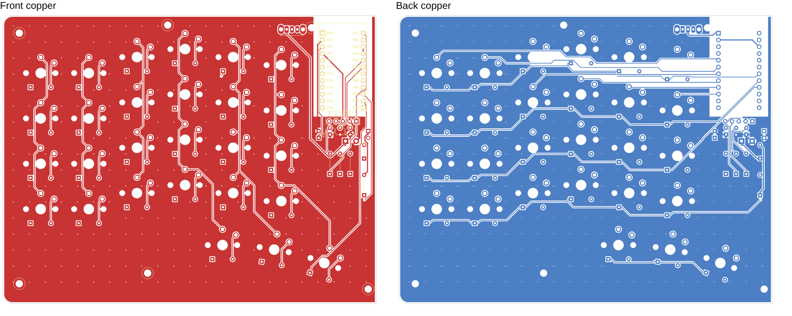

# PCB review: grounding, clearances, EMI and manufacturability

A check of all twelve boards (THT and SMT, Choc and MX, left, right and mono) against common PCB
problems, done in November 2026 with KiCad 7's DRC and scripted checks. Fixes are in the boards
and Gerbers in this repo.



## What was wrong, and what changed

| Issue | Found | Fix |
|---|---|---|
| **Power traces at signal width** | The 0.4 mm "Power" net class never took effect: ergogen pins every net to the default class, and KiCad 7's Python API can't change the pattern. GND, RAW, BAT_P, VCC and the charge link were routed at 0.25 mm. | `tools/prep_dsn.py` now puts those nets in the Power class in the Freerouting input and the project file. The THT boards were re-routed: power is 0.4 mm. The SMT boards keep 0.25 mm, which is still fine (see *Current*). |
| **No ground plane** | Both layers had only tracks. Signals had no nearby return path, and nothing shielded the matrix lines. | New `tools/add_ground.py`: a GND pour on both layers (0.3 mm clearance, thermal reliefs) and GND stitching vias on a 6 mm grid wherever both pours are solid (about 180–220 per half, 350–430 on a mono). Isolated islands are removed. Applied to all twelve boards. |
| **Copper near the controller's antenna** | Nothing kept copper away from the nice!nano. Nice Keyboards' docs don't say which end its antenna is. | A no-pour area over the whole controller plus 2 mm, on both layers, so the antenna end is clear whichever end it is. The few tracks under the controller are unavoidable (they go to its pins) and are normal for Pro Micro boards. |
| **Dangling track stubs** | Freerouting left short dead-end stubs: 2–3 on some THT boards, 4–13 on the SMT boards. They're harmless, but they're small antennas and DRC warnings. | Removed by `add_ground.py`. |
| **Starved thermal reliefs** | Once poured, one or two GND pads per board (a battery pad, an LED cathode, the display GND or a pogo pin) only got one thermal spoke, because tracks were in the way. | Those pads connect solid to the pour. They're small, so they still solder easily. Every other GND pad keeps its thermal relief. |
| **Silkscreen overlap** | The nice!view pin labels overlapped the new status-LED outlines. | Labels moved to the other side of the header. LED labels raised to 0.8 mm text. |

## Checked and fine

* **DRC:** 0 errors and 0 unconnected pads on all twelve boards. The remaining warnings are cosmetic:
  silkscreen over pads (JLC clips it), the five 0.6 mm nice!view pin labels (under JLC's 0.8 mm guideline, but they only need to be roughly legible), and
  "footprint not in a library" (ergogen generates the footprints inline).
* **Clearances (JLC's 2-layer limits in brackets):** track to track 0.2 mm (0.127), pour to
  anything 0.3 mm, copper to board edge 0.5 mm (0.3), hole to hole 0.25 mm. Tracks 0.25 mm signal,
  0.4 mm power (0.127). Vias 0.6 / 0.3 mm, a 0.15 mm ring (0.13 min). THT pads 1.6 / 0.8 mm.
* **Current:** the most current anything carries is about 100 mA, while the controller charges the
  other half over the charge link. Even 0.25 mm of 1 oz copper carries about 0.7 A with a 10 °C rise.
  0.4 mm carries about 1 A. Voltage drop over the longest power track is under 5 mV.
* **EMI:** the board itself carries only slow signals. The key matrix is scanned at a few kHz with
  millisecond edges. USB, the radio and the battery charger all live on the nice!nano. With the
  pours and stitching, every matrix line now runs over or beside ground. There's nothing here
  that needs impedance control or filtering.
* **Decoupling:** none needed on this board. The nice!nano has its own regulator and capacitors, and
  the switches, diodes and LEDs don't need any.
* **Key matrix:** `tools/check_matrix.py` passes on all twelve: one diode per key, col2row, no shared
  positions. That's full n-key rollover.

## Known limits (not changed)

* **ESD on the pogo contacts:** the charge link's two contacts are exposed on the join face when the
  halves are apart. The battery side goes through the PTC and 10 Ω resistor, which limit a discharge,
  and the contacts sit recessed in the case. A TVS diode would be better, but it would be the only
  SMD part on the THT boards. Leaving it out is a reasonable trade for a keyboard.
* **Battery polarity:** there's no reverse-polarity protection, and the nice!nano has none either.
  The silkscreen marks `+`, and the pouch cell's leads are soldered once. Buy cells with a built-in
  protection board (most 402030 cells have one).
* **Antenna end:** unverified. The keep-out covers both ends to be safe. If Nice Keyboards confirms
  the end, the keep-out could shrink to that end only and the pour would grow a little.
* **Not run:** JLC's online DFM check, because quote pages can't be reached from this environment.
  Their Gerber viewer runs the same checks when you upload, so look at its report before paying.

## Re-running

```sh
python3 tools/prep_dsn.py build/ergogen/pcbs/left.kicad_pcb pcb/left/yoga_left.kicad_pcb left.dsn
java -jar freerouting-2.1.0.jar --gui.enabled=false -de left.dsn -do left.ses -mp 200
python3 tools/import_ses.py pcb/left/yoga_left.kicad_pcb left.ses left-drc.txt
python3 tools/add_ground.py pcb/left/yoga_left.kicad_pcb left-drc.txt   # pours, stitching, stubs, DRC
tools/export_gerbers.sh pcb/left/yoga_left.kicad_pcb pcb/gerbers/yoga_left-gerbers.zip
```
