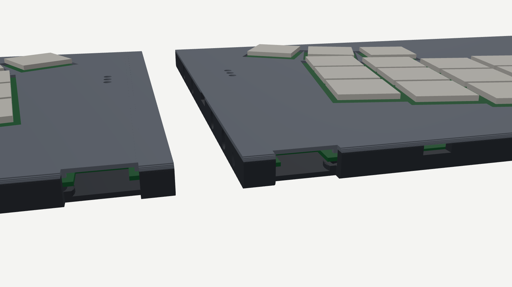

# Thin build: Kailh PG1316S scissor-style switches

A thinner version of the default 3-row split, built around Kailh's **PG1316S** ultra-low-profile
(laptop-style) switch, with the nRF52840 soldered to the PCB instead of a nice!nano. Same layout,
matrix, charge link and docking as the 3-row build, and the same nice!nano firmware. Files: `ergogen-thin/` (generated by `tools/make_thin.py`), `pcb-thin/`, `case/case_thin.scad`,
`case/stl-thin/`, `case/outlines-thin/`.

**Everything fits inside the stock keyboard's 7.8 mm, which includes its keys**, so it should go
into the folio like the stock one. The top is one flat plate at 6.1 mm with the keycaps standing
1.7 mm above it (7.8 mm to the key tops), so the thumb keys can be pressed with the side of the
thumb. Nothing else rises above the plate. For comparison, the Choc build is about 12.7 mm to the
key tops.

## Stack-up

| Layer | z (mm) | Notes |
|---|---|---|
| Floor | 0 – 1.0 | 6 × 1.5 mm docking magnets in bosses, as in the standard case. 0.6 mm under the cell |
| Cell | 0.6 – 4.6 | 403040 through a notch in the PCB's front corner |
| PCB | 2.8 – 3.6 | Ordered at **0.8 mm**, on standoffs with heat-set inserts. M2 low-head screws from the top |
| PG1316S switch + cap | 3.6 – 7.8 | 4.2 mm tall with its cap. The key tops match the stock keyboard's thickness |
| nRF52840 module | 3.6 – 5.65 | Raytac MDBT50Q-1MV2 on the PCB. The plate above it is pocketed to a 0.3 mm skin |
| USB-C | 2.0 – 5.2 | Mid-mount receptacle in a notch in the PCB's back edge |
| Flat top plate | 5.3 – 6.1 | One plane over everything. Caps rise 1.7 mm through it |

A nice!nano is 3.2 mm tall, almost as tall as a switch with its cap, so no flat top could cover it
and still leave the caps proud. The bare module is 2.05 mm, which fits under the plate. Everything
else on the top side is under 1.5 mm.

## On-board controller

The nice!nano's parts go straight onto the PCB, and JLC places them with everything else:

| Part | What | LCSC |
|---|---|---|
| Raytac MDBT50Q-1MV2 | nRF52840 module with chip antenna, 10.5 × 15.5 × 2.05 mm. Its antenna end sits at the back edge, with no copper under or beside it | C5118826 |
| 16-pin mid-mount USB-C | Sits in a 9.1 × 5.5 mm notch in the PCB's back edge (footprint from the nRFMicro) | C168688 |
| TP4054 | Li-ion charger, 100 mA (10 kΩ on PROG), as on the nRFMicro | C32574 |
| AO3401A + B5819W | Power path: with USB plugged in, the board runs from USB through the Schottky and the P-MOSFET disconnects the cell; without USB the cell (through the slide switch) feeds the nRF52840's VDDH. Same as the nRFMicro | ? |
| USBLC6-2SC6 | ESD clamp on D+, D− and VBUS | C7519 |
| 32.768 kHz crystal + 2 × 20 pF | Low-frequency clock, which the nice!nano firmware expects | C32346 |
| 0805 capacitors and resistors | 4.7 µF on VBUS, VDDH, VDD and the cell; 5.1 kΩ on CC1/CC2; 100 kΩ gate pull-down | basic parts |
| SWD header | 1 × 4, 2.54 mm through-holes (VDD, SWDIO, SWDCLK, GND, pin 1 square), nothing fitted. The holes are staggered so a plain pin header pressed in from the top holds without solder | none |

It's wired like a nice!nano v2 (VDDH from the battery, the internal DC/DC on,
battery voltage read from VDDH), so it runs the **nice!nano firmware**. Only the GPIOs differ: the
PCB uses the module pads on its outer rows so everything routes on two layers, and a small shield,
`yoga_thin_mcu`, points the pro-micro pin numbers at those GPIOs. The `yoga_thin_left`,
`yoga_thin_right` and `yoga_thin_mono` builds in `build.yaml` add it. The pin table lives in
`tools/make_thin.py` (`PROMICRO_TO_PAD`) and in the shield; keep them in step.

**First flash.** A fresh module has no bootloader. Once per board, connect a cheap SWD probe (a
Raspberry Pi Pico running debugprobe, an ST-Link clone or a J-Link, about $10–15) to the SWD header
(lift the top frame off; press a 4-pin header into the holes or use a probe's Dupont leads on one) and flash the nice!nano's UF2 bootloader (the Adafruit nRF52 bootloader built for
the nice!nano). Do this before closing the case. After that it works like a nice!nano, except that
there's no reset button (the module's reset pin is an inner pad that won't route on two layers): press
the `&bootloader` key on the Adjust layer of the half you want to update, at the bottom outer corner, and
drag the `.uf2` onto the drive that appears. If a bad firmware ever stops the keys working, the SWD header
gets it back.

## What changes from the Choc build

* **Switches:** PG1316S on every key. They're SMD only, so JLC reflows them with everything else
  (no hand soldering). Land pattern from two open-source footprints that agree with each other
  (`ergogen/footprints/pg1316s.js`). Spacing stays 18 × 17 mm; the caps are about 16 × 16.25 mm.
* **Inner thumb is 1u here.** Nobody sells 1.5u PG1316S caps that I could find.
* **Everything on the top side:** diodes (SOD-123, between the columns), side slide switch, 1206
  fuse and resistor, an SMD TVS on the charge contact (SMF10A, SOD-123FL), and three 0805 status
  LEDs with resistors. The PCB's underside is bare.
* **No nice!view:** it's too tall. The three status LEDs (same pins and firmware as the LED option)
  show through holes in the top plate.
* **No nice!nano:** see *On-board controller* above. The USB-C port sits at the bottom of a 12.5 mm
  wide notch in the case's back edge, because a plug's overmold is taller than the case.
* **Battery:** a **403040** cell (4.0 × 30 × 40 mm, typically about 500 mAh; check the one you buy)
  in the empty front corner of each half, in front of the outer columns. The PCB has a notch there,
  open to the front edge, and the floor under it is 0.6 mm, so the cell sits at 0.6 – 4.6 mm, with
  0.7 mm to the plate for swelling. Its leads solder to the `BT` pads beside the notch. That's about
  four times a 301230 cell: a few weeks per charge on the left (central) half, longer on the right.
  The mono has a notch in both corners; use either. A 5 mm 503040 (about 600 mAh) would need a
  second, 0.5 mm bump over that corner. Two candidate docking-magnet sites moved out of that corner.
* **Join:** the face is 6.1 mm tall, so four 4 × 2 mm magnets and two 2 × 10 mm dowel
  pins (5 mm in each half, at the ends of the join) replace the 6 mm magnets and 3 mm pins. The
  pogo charge link is unchanged.
* **Screws:** M2 low-head screws from the top, through the PCB into heat-set inserts in floor
  standoffs, as in the standard case. The top plate drops onto the walls over them.
* **Top-side part heights:** everything on top must stay under 1.5 mm (the plate's underside is
  1.7 mm above the PCB). The SOD-123 diodes, 0805 LEDs and 1206 parts are about 1.1 mm. Check the
  side slide switch (MSK-12C02 class, about 1.4 mm) and the pogo connector: the plate is pocketed
  to give the pogo body 2.2 mm.
* **Firmware:** `yoga_thin_left`, `yoga_thin_right` and `yoga_thin_mono` from `build.yaml` (the
  3-row shields, the status-LED shield and `yoga_thin_mcu`, on the `nice_nano_v2` board). The
  physical layout still draws the inner thumb 1.5u, which only affects how keymap editors draw it.

## Caveats to check before ordering

1. **Keycaps.** This is the main risk. PG1316S caps aren't a common item: one vendor's 10-packs
   reportedly came with a single cap. Confirm you can buy 42 caps (plus spares) before ordering
   boards.
2. **JLC assembly of the switches.** I couldn't confirm that LCSC stocks the PG1316S. If it doesn't,
   use JLC's consigned-parts service (you ship the switches to them), or their global sourcing.
   Either adds lead time.
3. **The TVS land pattern** uses the SOD-123 footprint. SMF10A is SOD-123FL, which usually fits a
   SOD-123 land, but check against the datasheet of the part you pick.
4. **Folio fit:** the key tops are at 7.8 mm, the stock keyboard's thickness, and nothing else is
   taller. The pocket test is still worth doing, since the stock keys may sit lower than its frame.
5. **The on-board controller is a first design.** It follows the nRFMicro's proven circuit and
   Raytac's land pattern, but nobody has built this board. Things to check: the module's antenna
   range from the back edge, with the laptop's screen under it; the mid-mount USB-C on a 0.8 mm board
   (the nRFMicro used 1.6 mm); and the part rotations in JLC's placement preview.
6. **JLC assembly type.** The MDBT50Q-1MV2 is a "Standard" PCBA part only, so the order can't use
   the cheaper Economic assembly. LCSC numbers marked `?` in the BOM still need picking.

## Cost

Roughly the SMT build's cost (≈ $380 for a first 3-row split, see
[cost-comparison.md](cost-comparison.md)), give or take $40. The PG1316S switches are cheaper than
Choc switches (about $0.65 each in 10-packs from HolyKeebs when last listed), but every part is now
machine-assembled, the switches may need consignment, and the caps' price is unknown. Dropping the
two nice!nanos saves about $50, which roughly pays for the modules and support parts on JLC's
minimum of two boards per design, the extended-part fees and Standard assembly. Add a $10–15 SWD
probe for the first flash.

## PCB check

Same checks as the [PCB review](pcb-review.md): ground pours on both layers, stitching vias, the
antenna keep-out, 0 DRC errors and 0 unconnected pads on left, right and mono, one diode per key.
The Gerbers are in `pcb-thin/gerbers/` and the JLC BOM/CPL files in `pcb-thin/fab/`.

These boards use 0.2 mm signal tracks with 0.15 mm gaps (0.4 mm power), finer than the other builds'
0.25 / 0.2 mm, because the module's 0.8 mm-pitch pads only escape outwards. That's well inside JLC's
standard 2-layer process. The mid-mount USB-C's pads and the tracks leaving them may come closer to
its notch than the 0.5 mm board-edge rule; the custom rules sit beside each board (`.kicad_dru`).
They were routed with Freerouting 1.9 (`xvfb-run java -jar freerouting-1.9.0.jar -de … -do … -mp 100`):
2.1 wrote incomplete session files for these boards.
