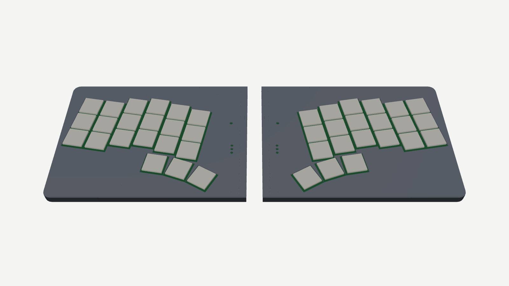

# Thin build: Kailh PG1316S scissor-style switches

A thinner version of the default 3-row split, built around Kailh's **PG1316S** ultra-low-profile
(laptop-style) switch. Same layout, matrix, firmware pins, charge link and docking as the 3-row
build. Files: `ergogen-thin/` (generated by `tools/make_thin.py`), `pcb-thin/`, `case/case_thin.scad`,
`case/stl-thin/`, `case/outlines-thin/`.

**The case is 6.9 mm thick with a flat top, and the keycaps stand 1.7 mm above it (8.6 mm to the
key tops)**, so the thumb keys can be pressed with the side of the thumb. For comparison, the stock
keyboard is 7.8 mm and the Choc build about 12.7 mm to the key tops.

## Stack-up

| Layer | z (mm) | Notes |
|---|---|---|
| Floor | 0 – 1.0 | 6 × 1.5 mm docking magnets in bosses, as in the standard case. 0.4 mm skin under the nice!nano, 0.6 mm under the cell |
| nice!nano | 0.4 – 3.6 | Soldered flat to the PCB's **underside**, components facing down, in a pocket in the floor |
| Cell | 0.6 – 5.6 | 503040 through a notch in the PCB's front corner |
| PCB | 3.6 – 4.4 | Ordered at **0.8 mm**, on standoffs with heat-set inserts. M2 low-head screws from the top |
| PG1316S switch + cap | 4.4 – 8.6 | 4.2 mm tall with its cap |
| Flat top plate | 6.1 – 6.9 | One plane over everything. Caps rise 1.7 mm through it |

Why the nice!nano goes underneath: it's 3.2 mm tall, almost as tall as a switch with its cap, so on
top of the PCB it would stick up through any flat top that the caps still clear. Under the PCB its
pins map exactly as in the usual components-down mounting, so the PCB and firmware don't change.
Everything left on the top side is under 1.5 mm.

## What changes from the Choc build

* **Switches:** PG1316S on every key. They're SMD only, so JLC reflows them with everything else
  (no hand soldering). Land pattern from two open-source footprints that agree with each other
  (`ergogen/footprints/pg1316s.js`). Spacing stays 18 × 17 mm; the caps are about 16 × 16.25 mm.
* **Inner thumb is 1u here.** Nobody sells 1.5u PG1316S caps that I could find.
* **Everything on the top side:** diodes (SOD-123, between the columns), side slide switch, 1206
  fuse and resistor, an SMD TVS on the charge contact (SMF10A, SOD-123FL), and three 0805 status
  LEDs with resistors. The PCB's underside is bare.
* **No nice!view:** it's too tall. The three status LEDs (same pins and firmware as the LED option)
  show through holes in the top plate.
* **nice!nano soldered flat to the PCB's underside**, no header or socket, components facing down
  (the silkscreen outline is on the top side; the module goes on the other face, same position and
  orientation). Trim its pins flush on top. Its USB-C port lines up with the case opening.
* **Battery:** a **503040** cell (5.0 × 30 × 40 mm, typically about 600 mAh; check the one you buy)
  in the empty front corner of each half, in front of the outer columns. The PCB has a notch there,
  open to the front edge, and the floor under it is 0.6 mm, so the cell sits at 0.6 – 5.6 mm, under
  the flat top. Its leads solder to the `BT` pads beside the notch. That's over five times a
  301230 cell: a few weeks per charge on the left (central) half, longer on the right. The mono
  has a notch in both corners; use either. Two candidate docking-magnet sites moved out of that
  corner.
* **Join:** the face is 6.9 mm tall, so four 4 × 2 mm magnets and two 2 × 10 mm dowel
  pins (5 mm in each half, at the ends of the join) replace the 6 mm magnets and 3 mm pins. The
  pogo charge link is unchanged.
* **Screws:** M2 low-head screws from the top, through the PCB into heat-set inserts in floor
  standoffs, as in the standard case. The top plate drops onto the walls over them.
* **Top-side part heights:** everything on top must stay under 1.5 mm (the plate's underside is
  1.7 mm above the PCB). The SOD-123 diodes, 0805 LEDs and 1206 parts are about 1.1 mm. Check the
  side slide switch (MSK-12C02 class, about 1.4 mm) and the pogo connector: the plate is pocketed
  to give the pogo body 2.2 mm.
* **Firmware:** `yoga3_split_left_leds`, `yoga3_split_right_leds` and `yoga3_mono_leds` from
  `build.yaml` (the 3-row shields plus the status-LED shield). The physical layout still draws the
  inner thumb 1.5u, which only affects how keymap editors draw it.

## Caveats to check before ordering

1. **Keycaps.** This is the main risk. PG1316S caps aren't a common item: one vendor's 10-packs
   reportedly came with a single cap. Confirm you can buy 42 caps (plus spares) before ordering
   boards.
2. **JLC assembly of the switches.** I couldn't confirm that LCSC stocks the PG1316S. If it doesn't,
   use JLC's consigned-parts service (you ship the switches to them), or their global sourcing.
   Either adds lead time.
3. **The TVS land pattern** uses the SOD-123 footprint. SMF10A is SOD-123FL, which usually fits a
   SOD-123 land, but check against the datasheet of the part you pick.
4. **The nice!nano's flat side** must be flat for it to sit against the PCB. If yours has parts
   there, use 1 mm spacers and raise `pcb_z` in `case_thin.scad` by 1 mm.
5. **Folio fit:** 8.6 mm to the key tops is thicker than the stock 7.8 mm keyboard, so it may not
   go into the folio's keyboard pocket. The pocket test is still open.

## Cost

Roughly the SMT build's cost (≈ $380 for a first 3-row split, see
[cost-comparison.md](cost-comparison.md)), give or take $30. The PG1316S switches are cheaper than
Choc switches (about $0.65 each in 10-packs from HolyKeebs when last listed), but every part is now
machine-assembled, the switches may need consignment, and the caps' price is unknown.

## PCB check

Same checks as the [PCB review](pcb-review.md): ground pours on both layers, stitching vias, the
controller keep-out, 0 DRC errors and 0 unconnected pads on left, right and mono. The Gerbers are in
`pcb-thin/gerbers/` and the JLC BOM/CPL files in `pcb-thin/fab/`.
